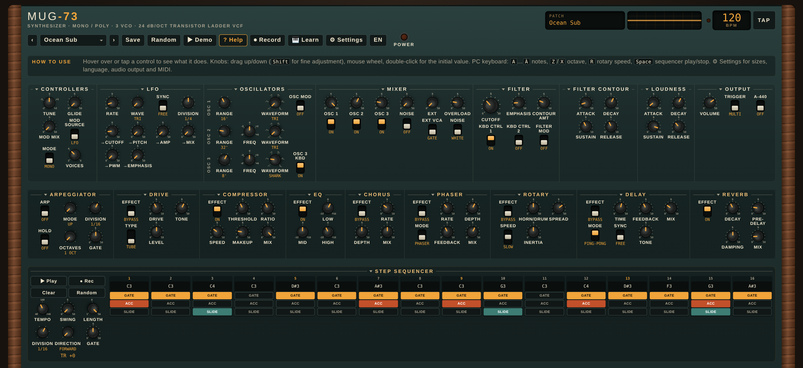

[English](README.md) · **Italiano**

# Mug-73

Sintetizzatore in stile analogico anni '70, **mono o polifonico** (2–8 voci): tre oscillatori, filtro ladder a 24 dB/ottava, due inviluppi, LFO, arpeggiatore, step sequencer, catena di effetti completa e ingresso audio esterno. Funziona come **plugin CLAP** nel tuo DAW e come **app standalone** su Windows, macOS e Linux.

**[Scarica l'ultima versione](../../releases/latest)**

[](https://ko-fi.com/mat73)



## Caratteristiche

**Generazione del suono**
- 3 oscillatori, ciascuno con 6 registri (LO, 32', 16', 8', 4', 2') e 6 forme d'onda (triangolare, dente di squalo, dente di sega, quadra, impulso largo e stretto); intonazione fine su oscillatori 2 e 3, e l'oscillatore 3 può seguire la tastiera o fare da modulatore a bassa frequenza.
- Generatore di rumore (bianco o rosa) e mixer con interruttore e livello per ogni sorgente, più **Overload**: spingi il mixer nel filtro per il classico suono saturo.
- **Mono o poly** (2–8 voci), con trigger multi o legato, glide, accordatura, riferimento A-440 e velocity → accento.

**Ingresso esterno (EXT)**
- Una voce, una chitarra, un loop di batteria o una traccia qualsiasi entra nel mixer come un oscillatore in più e passa dal filtro ladder e dall'amplificatore, come l'ingresso esterno dei classici sintetizzatori semimodulari.
- Manopola **Ext** nel MIXER (5 = livello originale, 10 = +12 dB) e interruttore **Ext VCA**: *Gate* (si sente solo mentre suoni, con l'inviluppo) oppure *Drone* (sempre aperto, il filtro lavora anche tra una nota e l'altra).
- Spegni i tre oscillatori e suona filtro e inviluppi solo col tuo suono.
- Nel DAW è un **ingresso sidechain** chiamato "Ext"; nello standalone scegli l'ingresso audio nelle Settings. Con Ext a zero non costa nulla.

**Filtro e inviluppi**
- Filtro ladder a 4 poli (24 dB/ottava) con enfasi (risonanza), quantità di contour, due interruttori di keyboard tracking e modulazione.
- Due inviluppi ADSR (filtro e volume) da 1 ms a 10 s.

**Modulazione**
- LFO con 5 forme d'onda (triangolare, quadra, sample & hold, sega discendente, rampa), libero o sincronizzato al tempo con 9 divisioni, diretto a intonazione, cutoff, enfasi, ampiezza, larghezza d'impulso e al morphing tra gli oscillatori.
- Mod wheel e pitch bend (±2 semitoni).

**Arpeggiatore e sequencer**
- Arpeggiatore: su, giù, su/giù, casuale, come suonato; 1–4 ottave, hold, swing, gate, 6 divisioni.
- Sequencer a 16 passi con accento e slide per passo, lunghezza 1–16, 4 direzioni, 6 divisioni. Entrambi seguono tempo e transport del DAW (o un clock interno).

**Effetti**
- Drive (valvola, hard, fuzz), compressore, EQ a 3 bande, phaser / flanger, chorus, rotary (freno, lento, veloce, con inerzia), delay (mono o ping-pong, sincronizzabile al tempo), riverbero con pre-delay e damping.

**Preset e controllo**
- 170 preset di fabbrica in 12 gruppi (bassi, lead, pad, ambient, arpeggi, sequencer, tastiere, organi, effetti…); salvi i tuoi, modifichi il file a mano, importi ed esporti.
- **MIDI Learn** su ogni controllo, program change, CC1 e tastiera a schermo.
- Interfaccia ridimensionabile con barra di aiuto, oscilloscopio e dimensioni di manopole e testo regolabili.
- Leggerissimo per la CPU (circa 2–3% di un core con tutti gli effetti), quindi vanno bene i buffer piccoli.

## Installazione

1. Scarica da **Releases** lo zip per il tuo sistema e decomprimilo.
2. Copia `Mug-73.clap`:
   - **Windows**: `C:\Program Files\Common Files\CLAP\`
   - **macOS**: `~/Library/Audio/Plug-Ins/CLAP/`, poi `xattr -dr com.apple.quarantine ~/Library/Audio/Plug-Ins/CLAP/Mug-73.clap` (i file non sono firmati)
   - **Linux**: `~/.clap/`
3. Riscansiona i plugin nel DAW: **Mug-73** compare tra gli strumenti.

I file non sono firmati digitalmente, quindi Windows SmartScreen può avvisarti la prima volta.

Per la latenza più bassa su Windows usa nel DAW il driver ASIO della tua scheda audio con buffer di 64–256 campioni.

> Il **VST3** non è incluso. Usa la versione CLAP (supportata da Bitwig, REAPER, FL Studio, Studio One, MultitrackStudio e altri) o l'app standalone.

## App standalone

Avvia `Mug-73` (`Mug-73.exe` su Windows). Suona sull'uscita audio di sistema e collega la prima tastiera MIDI che trova. Puoi suonare anche con la tastiera a schermo o quella del PC (A W S E D F T G Y H U J K O L P; Z/X cambiano ottava; Spazio avvia il sequencer).

```
Mug-73 --midi-input ""         elenca gli ingressi MIDI
Mug-73 --midi-input "nome"     usa quell'ingresso
Mug-73 --output-device ""      elenca le uscite audio
Mug-73 --period-size 128       buffer in campioni
Mug-73 --help                  tutte le opzioni
```

Le Settings (livello uscita, uscita audio, **ingresso audio per EXT**, buffer, ingresso MIDI, dimensione dell'interfaccia) si salvano e si applicano riavviando l'app. L'ingresso audio all'inizio è spento perché un microfono aperto non inneschi un fischio: usa le cuffie.

## Segnalazioni

Bug e richieste: apri una [issue](../../issues), indicando sistema, DAW e versione del plugin.

## ☕ Sostegno

Mug-73 è gratuito. Se ti è utile, o ti diverti a suonarlo, una piccola mancia su Ko-fi mi aiuta a migliorarlo e ad aggiungere nuovi suoni. Grazie!

[](https://ko-fi.com/mat73)

## Licenza

Uso gratuito, anche per la musica che pubblichi o vendi; vietata la ridistribuzione. Vedi [LICENSE.txt](LICENSE.txt). Componenti di terze parti: [THIRD-PARTY-NOTICES.md](THIRD-PARTY-NOTICES.md).
