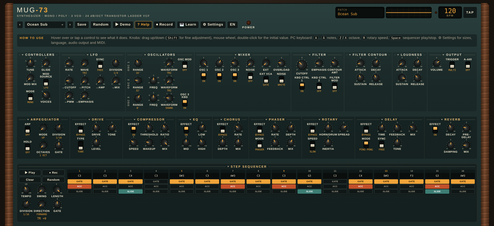

**English** · [Italiano](README.it.md)

# Mug-73

A 1970s-style analog-inspired synthesizer, **mono or polyphonic** (2–8 voices): three oscillators, a 24 dB/oct ladder filter, two envelopes, LFO, arpeggiator, step sequencer, a full effects chain and an external audio input. It runs as a **CLAP plugin** in your DAW and as a **standalone app** on Windows, macOS and Linux.

**[Download the latest release](../../releases/latest)**

[](https://ko-fi.com/mat73)



## Features

**Sound generation**
- 3 oscillators, each with 6 ranges (LO, 32', 16', 8', 4', 2') and 6 waveforms (triangle, sharktooth, sawtooth, square, wide and narrow pulse); detune on oscillators 2 and 3, oscillator 3 can follow the keyboard or run as a low-frequency modulator.
- Noise generator (white or pink) and a mixer with a switch and a level for every source, plus **Overload**: push the mixer into the filter for the classic saturated sound.
- **Mono, poly or unison** (2–8 voices), with multi or legato trigger, glide, tuning, A-440 reference and velocity → accent.
- **VOICING**: unison stacks with detune, poly and unison voices spread across the stereo field, analog **drift** of oscillators and cutoff, and the **feedback** loop (the output patched back into the mixer) for growling basses and leads.

**External input (EXT)**
- A voice, a guitar, a drum loop or any track enters the mixer as one more oscillator and goes through the ladder filter and the amplifier, like the external input of the classic semi-modular synths.
- **Ext** knob in the MIXER (5 = original level, 10 = +12 dB) and an **Ext VCA** switch: *Gate* (heard only while you play, shaped by the envelope) or *Drone* (always open, the filter keeps working between notes).
- Turn the three oscillators off and play the filter and envelopes with your own sound only.
- In a DAW it is a **sidechain input** called "Ext"; in the standalone app you choose an audio input in Settings. With Ext at zero it costs nothing.
- **VOICE-IN pitch tracker**: sing or play into the input and the Mug-73 follows your pitch (notes, fine pitch as bend, dynamics opening the filter, optional direct voice to the effects). A demo voice and guitar let you try it without a microphone.

**Filter and envelopes**
- 4-pole (24 dB/oct) ladder filter with emphasis (resonance), contour amount, two keyboard-tracking switches and modulation.
- Two ADSR envelopes (filter and loudness) from 1 ms to 10 s.

**Modulation**
- LFO with 5 waveforms (triangle, square, sample & hold, saw down, ramp up), free or synced to the tempo with 9 divisions, routed to pitch, cutoff, emphasis, amplitude, pulse width and the morph between oscillators.
- Mod wheel and pitch bend (±2 semitones).

**Arpeggiator and sequencer**
- Arpeggiator: up, down, up/down, random, as played; 1–4 octaves, hold, swing, gate, 6 divisions.
- 16-step sequencer with accent and slide per step, length 1–16, 4 directions, 6 divisions. Both follow the DAW tempo and transport (or an internal clock).

**Effects**
- Drive (tube, hard, fuzz), compressor, 3-band EQ, phaser / flanger, chorus or string-machine **ensemble**, rotary speaker (brake, slow, fast, with inertia), delay (mono or ping-pong, tempo-synced, clean or **tape** with wow, flutter and runaway feedback), reverb (**hall** or **plate**) with pre-delay and damping.

**Presets and control**
- 190 factory presets in 13 groups (bass, lead, pad, ambient, arpeggios, sequencer, keys, organs, effects… and **Vintage 73**, twenty sounds built on unison, ensemble, tape echo and plate); save your own, edit the preset file by hand, import and export.
- **MIDI Learn** on every control, program change, CC1, and a built-in on-screen keyboard.
- Resizable 70s-style interface: walnut cheeks, brushed-aluminium knob skirts, back-lit VU meters, an oscilloscope, a help bar, adjustable knob and text size.
- Very light on the CPU (a mono voice takes about 0.5% of one core, all effects on about 2–3%), so small buffers are fine.

## Install

1. Download the zip for your system from **Releases** and unzip it.
2. Copy `Mug-73.clap`:
   - **Windows**: `C:\Program Files\Common Files\CLAP\`
   - **Linux**: `~/.clap/`
3. Rescan plugins in your DAW: **Mug-73** appears among the instruments.

The files are not digitally signed, so Windows SmartScreen may warn you the first time.

For the lowest latency on Windows use the ASIO driver of your audio interface in the DAW with a 64–256 sample buffer.

> **VST3** is not included. Use the CLAP version (supported by Bitwig, REAPER, FL Studio, Studio One, MultitrackStudio and others) or the standalone app.

## Standalone app

Run `Mug-73` (`Mug-73.exe` on Windows). It plays through the system audio output and connects the first MIDI keyboard it finds. You can also play the on-screen keyboard or the PC keyboard (A W S E D F T G Y H U J K O L P; Z/X change octave; Space starts the sequencer).

```
Mug-73 --midi-input ""         list MIDI inputs
Mug-73 --midi-input "name"     use that input
Mug-73 --output-device ""      list audio outputs
Mug-73 --period-size 128       buffer in samples
Mug-73 --help                  all options
```

Settings (output level, audio output, **audio input for EXT**, buffer, MIDI input, interface size) are saved and applied by restarting the app. The audio input is off at first so that an open microphone cannot feed back: use headphones.

## Feedback

Bugs and requests: open an [issue](../../issues). Please include your system, DAW and plugin version.

## ☕ Support

Mug-73 is free. If it is useful to you, or you just enjoy it, a small tip on Ko-fi helps me keep improving it and adding new sounds. Thank you!

[](https://ko-fi.com/mat73)

## Licence

Free to use, including for music you release or sell; not for redistribution. See [LICENSE.txt](LICENSE.txt). Third-party components: [THIRD-PARTY-NOTICES.md](THIRD-PARTY-NOTICES.md).
